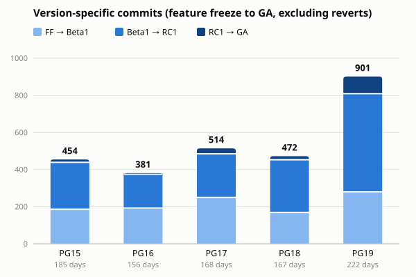
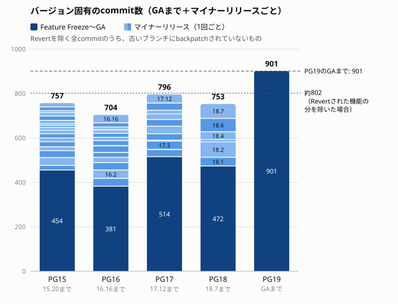
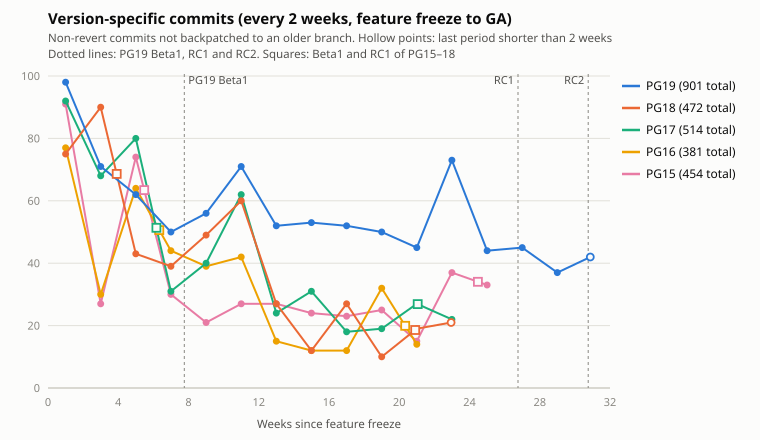
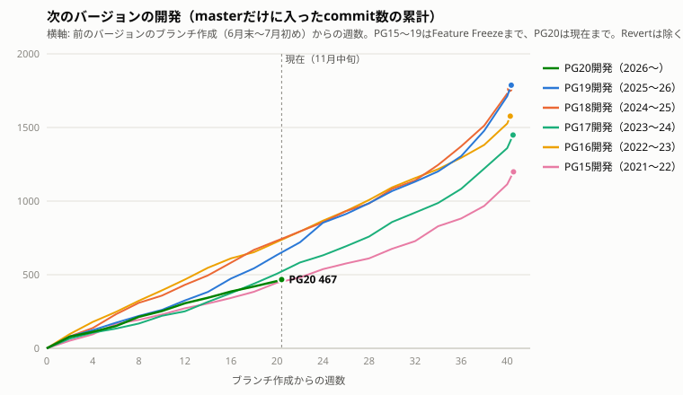

<em>This post was AI-translated from the <a href="/ja{{ page.url }}">Japanese original</a>.</em>

[PostgreSQL 19](https://www.postgresql.org/about/news/postgresql-19-released-3449/) was released on November 19, 2026! PostgreSQL 16 to 18 came out in mid to late September (PostgreSQL 15 in October), so this year's release was about two months late.

There are several reasons for the delay, and one of them is the rise of AI. AI-assisted review and testing led to far more bug reports than usual, including security issues, and handling them took a lot of developer time. Peter Eisentraut's post "[The reverts will continue until morale improves](https://peter.eisentraut.org/blog/2026/10/09/the-reverts-will-continue-until-morale-improves)" describes this in detail. There's also a view that features developed before AI review became common got reviewed by AI only after the beta started.

PostgreSQL 19 also drew some attention because several features were reverted during the beta after they had been committed (UPDATE/DELETE FOR PORTION OF, SQL/PGQ, ALTER TABLE ... MERGE/SPLIT PARTITION, online changes of data checksums, and so on).

It also felt that way to me: there were a lot of bug reports this time, and it was much busier than in past releases. So I counted how many bugs were reported and fixed between feature freeze and GA for PostgreSQL 19, and compared that with past years. I compare it with PostgreSQL 15 to 18.

## Open Items

The PostgreSQL project tracks issues found between feature freeze and release on the "Open Items" wiki page (for example, [PostgreSQL 19 Open Items](https://wiki.postgresql.org/wiki/PostgreSQL_19_Open_Items)). First, let's compare the number of items marked as resolved there.

| Version       | Resolved Open Items |
|---------------|---------------------|
| PostgreSQL 15 | 70                  |
| PostgreSQL 16 | 35                  |
| PostgreSQL 17 | 63                  |
| PostgreSQL 18 | 59                  |
| PostgreSQL 19 | **209**             |

That's 3 to 6 times the usual. Looking at the items, about 20 are about the new RI fast-path (faster foreign key checks) and close to 30 are about REPACK (CONCURRENTLY), so the problems were concentrated in the big new features.

## Counting commits

Counting Open Items is easy, but not every fix shows up there. Minor fixes are often committed without an Open Item, and one item can cover several fixes. So let's count fixes from the commit log instead.

No new features go in after feature freeze (April 2026), so almost everything committed after that is a fix of some kind. I counted every commit that went into the version's branch (`REL_19_STABLE` for PostgreSQL 19) between feature freeze and GA, except reverts, as a fix. Documentation and test fixes are included[^house].

[^house]: This also includes commits such as release notes and translation updates, but there are only a few to about 20 of them per version, so they hardly affect the results.

Of those, I call the ones that were not backpatched to the previous version's branch or older "version-specific fixes"[^backpatch]. A fix that was also backpatched to older branches fixes a bug that existed before that version, so a version-specific fix can be regarded as a fix for a bug introduced in that version.

[^backpatch]: To decide whether a commit was backpatched, I used the value of `Backpatch-through:` in the commit message, and whether a commit with the same subject exists on the previous version's branch within 60 days. The 60-day window is there so that common subjects like "Fix typo" don't match unrelated old commits.

The numbers below can change by a few percent depending on how they are counted (for example, which commits are treated as backpatched), so please take the exact counts as a rough guide. The differences between versions are much larger than that, though, so I think they are fine for looking at trends.

PostgreSQL 19 had 901, about 1.8 to 2.4 times the usual (381 to 514). The period was also 1 to 2 months longer than usual, so per day it's 4.1 against 2.4 to 3.1, or 1.3 to 1.7 times.

Looking at the number per day for each phase shows something a bit more interesting.

|               | FF → Beta1 | Beta1 → RC1 | RC1 → GA |
|---------------|------------|-------------|----------|
| PostgreSQL 15 | 4.7        | 1.9         | 1.4      |
| PostgreSQL 16 | 4.3        | 1.9         | 0.7      |
| PostgreSQL 17 | 5.7        | 2.3         | 1.6      |
| PostgreSQL 18 | 6.0        | 2.4         | 1.1      |
| PostgreSQL 19 | 5.1        | **4.0**     | **2.7**  |

From feature freeze to Beta1, PostgreSQL 19 is about the same as other years. Usually the pace of fixes drops to less than half after Beta1, but for PostgreSQL 19 it didn't drop much. In other words, almost all of the difference comes after the beta started. As Peter's post also says, from April to August many senior developers were busy with security issues, and they only really got to beta review and testing from August. Monthly numbers fit this too: PostgreSQL 19's version-specific fixes dropped once in August (107) and then went up again in September (124).

By the way, about 100 of PostgreSQL 19's fixes were for features that ended up being reverted (FOR PORTION OF, SQL/PGQ and so on). Even without them it's about 800, 1.6 to 2.1 times the usual. Also, PostgreSQL 19 was a big release to begin with: about 40% more lines were added during its development cycle than for PostgreSQL 18, so part of the reason for the larger number of bugs is probably just that.

### How many minor releases' worth?

My impression so far has been that bugs keep getting fixed in minor releases after x.0 comes out, and that people often start using a version around a year after GA (around x.3 or x.4). So how many of the usual post-GA minor releases do the 901 fixes PostgreSQL 19 made before GA correspond to?

Using the same criteria (excluding reverts, and not backpatched to older branches), I counted the commits in each minor release after GA and stacked them on top of the count up to GA.

None of PostgreSQL 15 to 18 reaches 901, even with every minor release up to the latest one stacked up. PostgreSQL 15, four years after GA, is at 757 as of 15.20. The closest is PostgreSQL 17, at 796 as of 17.12, more than two years after GA. PostgreSQL 19's 901 includes about 100 fixes for reverted features, so it may be fairer to compare against about 800 without them, but even then PostgreSQL 17 only just catches up by 17.12. So PostgreSQL 19 fixed before GA what would usually take about two years of minor releases.

Of course, PostgreSQL 19 had more code go in to begin with, so it's natural to some extent that it has more fixes. The number of lines added during the development cycle (from the previous version's branch point to feature freeze) was 180,000 to 230,000 for PostgreSQL 15 to 18, against about 325,000 for PostgreSQL 19. Normalized per 1,000 added lines, PostgreSQL 15 to 18 have 2.1 to 2.2 fixes and PostgreSQL 19 has 2.8, so the gap shrinks to about 1.2 to 1.3 times.

Note, though, that the numbers we compare against are moving too. Since 2026, AI-driven reports have also increased on the minor release side, and 18.6 and 18.7 each have 60 or more.

## Have the bugs settled down?

So, after fixing this much, are PostgreSQL 19's bugs settling down?

Usually there are about 75 to 90 in the first two weeks after feature freeze, going down to about 10 to 30 before GA. PostgreSQL 19 had 98 in the first two weeks, about the same as usual (slightly more), but after that it stayed at around 40 to 70 the whole time. There's a peak of 73 in mid-September (weeks 22 to 24).

The pace from RC1 to GA was 2.7 per day, lower than before RC1 (4.3 per day). But it's much higher than the same period in other years (0.7 to 1.6), and higher than PostgreSQL 18's average from Beta1 to RC1 (2.4). The last six weeks were 44, 45 and 37, only slightly lower, and 42 went in during the last 12 days before GA.

When more people use AI to look for bugs, more bugs get found even if the number of remaining bugs is the same. So the counts alone can't tell whether the high numbers mean "many bugs still remain" or "we look for them harder now".

Also, in November after RC1, preparing the minor releases (18.7 and others) took people's time too. 18.7 fixed as many as 53 CVEs.

At GA, there were no unresolved Open Items left.

## Beyond PostgreSQL 19

So far I've looked at PostgreSQL 19's version-specific fixes, but PostgreSQL 19 wasn't the only place with a lot of bug reports. Of the commits that went into `REL_19_STABLE` between feature freeze and GA, 697 were also backpatched to older branches, that is, fixes for bugs that existed before PostgreSQL 19. For PostgreSQL 15 to 18 it was about 170 to 240 in the same period, so that's 3 to 4 times.

Looking at the number of commits to the oldest supported branch (`REL_14_STABLE`), it was roughly flat at around 30 a month from 2024 through the first half of 2026, and doubled to an average of over 60 a month in the second half of 2026. November had 95 in the first half alone, and it's still going up.

It also feels that way to me: a very large number of bugs is being reported outside PostgreSQL 19 as well. Some are important and some aren't so much, and they all arrive mixed together in large numbers. This looks likely to continue, at least for a while.

## Any effect on PostgreSQL 20 development?

If PostgreSQL 19 bug fixing and security work took developers' time, it may also have affected the next version, PostgreSQL 20. PostgreSQL 20 development started when the `REL_19_STABLE` branch was created at the end of June. So I counted the commits that went only into master after the branch was created (not into `REL_19_STABLE`) as next-version development, and compared them with past years.

So far (about 20 weeks after the branch was created), 467 commits have gone in for PostgreSQL 20 development. At the same point, PostgreSQL 16 to 19 development had 520 to 739, so this is on the low side. PostgreSQL 20 kept about the same pace as PostgreSQL 19 development until around week 12 (late September), and then it slowed down. That is when the second half of the PostgreSQL 19 beta, the RCs and the minor release preparation overlapped.

However, PostgreSQL 15 development had 452 and PostgreSQL 17 development had 520 at the same point, so it's not far outside the usual range. Also, the pace of development varies a lot with what features are being developed for that version, and some of the features reverted from PostgreSQL 19 (such as online changes of data checksums) are still in master. So this comparison is only a rough reference.

## Summary

I counted the bug fixes in PostgreSQL 19 from feature freeze to GA.

- Both the Open Items and the commit log show many more bug fixes than usual
- Almost all of the difference from other years comes after the beta started
- The number fixed before GA is larger than what any previous version has fixed up to its latest minor release (about two years' worth)
- The pace of fixes is going down, but it's still higher than the same period in other years. The counts alone can't tell whether many bugs remain or we just look for them harder
- Outside PostgreSQL 19, the number of fixes on older branches keeps growing
- PostgreSQL 20 development is within the usual range, but on the low side

It's certain that a lot was fixed before GA. 19.0 may turn out to be a more stable release than past x.0 releases. On the other hand, whether only a few bugs remain to be fixed is still unknown. In about six months, I'd like to check this again, looking at how many PostgreSQL 19-specific fixes come out in 19.1 to 19.3 along with what happens to the fixes on older branches.
