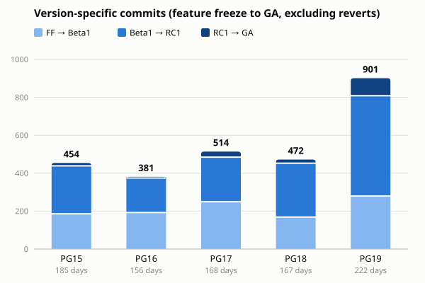

2026年11月19日に[PostgreSQL 19](https://www.postgresql.org/about/news/postgresql-19-released-3449/)がリリースされました！PostgreSQL 16〜18は9月中旬から下旬（PostgreSQL 15は10月）にリリースされていたので、今年は約2か月遅れたことになります。

遅れた理由はいくつかありますが、その一つはAIの台頭です。AIを使ったレビューやテストによって、セキュリティの問題を含むバグが例年よりずっと多く報告されるようになり、その対応に開発者の時間が取られました。このあたりの事情はPeter Eisentrautさんの記事「[The reverts will continue until morale improves](https://peter.eisentraut.org/blog/2026/10/09/the-reverts-will-continue-until-morale-improves)」に詳しく書かれています。AIのレビューが一般的になる前に開発された機能が、ベータ期間に入ってからAIのレビューを受けた、という見方もあります。

また、PostgreSQL 19では、一度コミットされた機能のうち、いくつかがベータ期間中にRevertされたことも少し話題になりました（UPDATE/DELETE FOR PORTION OF、SQL/PGQ、ALTER TABLE ... MERGE/SPLIT PARTITION、オンラインでのデータチェックサムの切り替えなど）。

自分の体感としても、今回はとにかくバグ報告が多く、例年のリリースと比べてずっと忙しい感じがありました。そこで、PostgreSQL 19のFeature FreezeからGAまでにどれくらいのバグが報告・修正されたのか、例年と比べてどうだったのかを数えてみました。比較対象はPostgreSQL 15〜18です。

## Open Itemsの数

PostgreSQLでは、Feature Freezeからリリースまでの間に見つかった問題を、Wikiの「Open Items」というページで管理しています（例えば[PostgreSQL 19 Open Items](https://wiki.postgresql.org/wiki/PostgreSQL_19_Open_Items)）。まずは、ここで「解決済み」になった項目の数を比べてみます。

| バージョン    | 解決済みのOpen Items |
|---------------|----------------------|
| PostgreSQL 15 | 70                   |
| PostgreSQL 16 | 35                   |
| PostgreSQL 17 | 63                   |
| PostgreSQL 18 | 59                   |
| PostgreSQL 19 | **209**              |

例年の3〜6倍です。中身を見てみると、新機能のRI fast-path（外部キーチェックの高速化）に関するものが約20件、REPACK (CONCURRENTLY)に関するものが30件近くあり、新しく入った大きな機能に問題が集中していたことがわかります。

## コミットログで数える

Open Itemsを数えることは手軽ですが、そこに全ての修正が載るわけではありません。軽微な修正はOpen Itemsに載せずにそのままコミットされることも多いですし、1つの項目に複数の修正がまとめられていることもあります。そこで、コミットログから修正の数を数えてみます。

Feature Freeze(2026年4月)以降は新しい機能は入らないので、その後にコミットされるのはほぼ全てが何らかの修正です。そこで、Feature FreezeからGAまでの間にそのバージョンのブランチ（PostgreSQL 19なら`REL_19_STABLE`）に入ったコミットのうち、Revertを除いた全てを修正として数えました。ドキュメントやテストの修正も含みます[^house]。

[^house]: リリースノートや翻訳の更新のようなコミットも含まれていますが、どのバージョンも数件から20件程度なので、結果にはほとんど影響しません。

[^backpatch]: backpatchされたかどうかは、コミットメッセージの`Backpatch-through:`の値と、1つ前のバージョンのブランチに同じタイトルのコミットが前後60日以内にあるかどうかで判定しました。「Fix typo」のようなよくあるタイトルが、無関係な古いコミットと一致してしまうのを避けるためです。

さらに、そのうち1つ前のバージョン以前のブランチにはbackpatchされていないものを「バージョン固有の修正」と呼ぶことにします[^backpatch]。古いブランチにもbackpatchされた修正は、そのバージョンより前からあったバグの修正なので、バージョン固有の修正は、そのバージョンで入ったバグの修正と考えられます。

なお、以降の数字は数え方（どのコミットをbackpatchされたものとみなすかなど）によって数%程度は変わるので、細かい件数は参考程度に見てください。ただ、バージョン間の差はそれよりもずっと大きいので、傾向を見る分には問題ないと思います。

PostgreSQL 19は901件で、例年（381〜514件）の約1.8〜2.4倍でした。期間も例年より1〜2か月長いので1日あたりで比べると、2.4〜3.1件に対して4.1件で、1.3〜1.7倍になります。

期間ごとに1日あたりの件数を見てみると、もう少し面白いことがわかります。

|               | FF → Beta1 | Beta1 → RC1 | RC1 → GA |
|---------------|-------------|--------------|-----------|
| PostgreSQL 15 | 4.7         | 1.9          | 1.4       |
| PostgreSQL 16 | 4.3         | 1.9          | 0.7       |
| PostgreSQL 17 | 5.7         | 2.3          | 1.6       |
| PostgreSQL 18 | 6.0         | 2.4          | 1.1       |
| PostgreSQL 19 | 5.1         | **4.0**      | **2.7**   |

Feature FreezeからBeta1までは、PostgreSQL 19は例年とほとんど変わりません。例年はBeta1を過ぎると修正のペースが半分以下に落ちますが、PostgreSQL 19はあまり落ちませんでした。つまり、例年との違いはほぼベータ期間に入ってからの分です。Peterさんの記事にも書いてありますが、4月から8月にかけて多くのシニアな開発者がセキュリティ問題の対応に追われ、ベータ版のレビューやテストに本格的に手が回り始めたのは8月からでした。月ごとに見ても、PostgreSQL 19固有の修正は8月に一度減った（107件）あと、9月に再び増えていて（124件）、この話とも合っています。

ちなみに、PostgreSQL 19のうち約100件は、最終的にRevertされた機能（FOR PORTION OFやSQL/PGQなど）に対する修正でした。これを除いても約800件で、例年の1.6〜2.1倍です。また、そもそもPostgreSQL 19は大きなリリースで、開発期間中に追加された行数はPostgreSQL 18より4割ほど多かったので、その分バグが多かったという面もあると思います。

### GA後のマイナーリリース何回分？

これまでの感覚では、x.0がリリースされた後もマイナーリリースでバグが潰されていって、だいたいGAから1年後くらいのバージョン（x.3〜x.4あたり）から使われることが多い印象でした。では、PostgreSQL 19がGAまでに直した901件は、例年のGA後のマイナーリリース何回分に相当するのでしょうか。

同じ条件（Revertを除き、古いブランチにbackpatchされていないもの）で、GA後にマイナーリリースごとに入ったコミットを数えて、GAまでの件数に積み上げてみました。

PostgreSQL 15〜18は、どれも最新のマイナーリリースまで積み上げても901件に届いていません。GAから4年経ったPostgreSQL 15も15.20までで757件です。一番近いのはPostgreSQL 17で、GAから2年以上経った17.12までで796件です。PostgreSQL 19の901件にはRevertされた機能に対する修正（約100件）も含まれているので、それを除いた約800件と比べるのが公平かもしれませんが、それでもPostgreSQL 17が17.12までにやっと並ぶくらいです。つまり、件数だけ見ると、PostgreSQL 19は、例年なら2年くらいかけてマイナーリリースで直していく分を、GAまでに直したことになります。

もちろん、PostgreSQL 19はそもそも入ったコードの量が多いので、修正の数が多いのはある程度自然です。開発期間（前のバージョンのブランチ作成からFeature Freezeまで）に追加された行数は、PostgreSQL 15〜18が18万〜23万行だったのに対して、PostgreSQL 19は約32.5万行でした。

ただし、比べる側の数も動いていることには注意が必要です。2026年に入ってからは、マイナーリリース側でもAIによる報告が増えていて、18.6と18.7はそれぞれ60件以上あります。

## バグは収束しているのか？

では、たくさん直した結果、PostgreSQL 19のバグは収束してきているのでしょうか。

例年は、Feature Freeze直後の2週間に75〜90件くらいあったのが、GA前には10〜30件くらいまで減っています。PostgreSQL 19も最初の2週間は98件と例年並み（やや多いくらい）でしたが、その後もずっと40〜70件くらいのまま推移しました。GA前の6週間でもまだ例年よりも多く修正が入っています。全体としては減少傾向にありますが、GA後にユーザがPostgreSQL 19を利用し始めること考えると、同等程度のバグ報告のペースはまだ続きそうです。

## PostgreSQL 20の開発への影響は？

PostgreSQL 19のバグ修正やセキュリティ問題の対応に開発者の時間が取られたとすると、次のバージョン、つまりPostgreSQL 20の開発にも影響が出ているかもしれません。PostgreSQL 20の開発は、6月末に`REL_19_STABLE`ブランチが作られてから始まっています。そこで、ブランチ作成後にmasterだけに入ったコミット（`REL_19_STABLE`には入っていないもの）を、次のバージョンの開発として数えて、例年と比べてみました。

現在（ブランチ作成から約20週）までに、PostgreSQL 20の開発としては467件のコミットが入っています。同じ時点で比べると、PostgreSQL 16〜19の開発では520〜739件だったので、それよりは少なめです。PostgreSQL 20は、12週目（9月下旬）くらいまではPostgreSQL 19の開発とほぼ同じペースでしたが、そこから伸びが鈍っています。ちょうど、PostgreSQL 19のベータ期間の後半からRC、マイナーリリースの準備が重なっていた時期です。

ただし、PostgreSQL 15の開発では同じ時点で452件、PostgreSQL 17の開発では520件だったので、例年の範囲から大きく外れているわけではありません。また、開発のペースはそのバージョンでどんな機能が開発されているかによっても大きく変わりますし、PostgreSQL 19でRevertされた機能のうち、いくつか（オンラインでのデータチェックサムの切り替えなど）はmasterには残ったままです。なので、この比較はあくまでも参考程度です。

## まとめ

PostgreSQL 19のFeature FreezeからGAまでのバグ修正を数えてみました。

- Open Itemsで見ても、コミットログで見ても、例年よりとても多くのバグが修正された
- 例年との違いは、ほぼベータ期間に入ってからの分
- GAまでに直した数は、これまでのどのバージョンが最新のマイナーリリースまでに直した数よりも多い（例年の2年分くらい）
- ただし、修正のペースは下がってきているものの、例年の同じ時期よりはまだ高い。バグが多く残っているのか、よく探すようになったのかは、件数だけではわからない
- PostgreSQL 19以外の古いブランチでも、修正の数は増え続けている
- PostgreSQL 20の開発は、例年の範囲内ではあるが少し少なめ

「GAまでにたくさん直した」のは確かです。19.0は、例年のx.0よりも安定したリリースになっているかもしれません。一方で、直すべき残っている少ないかどうかはまだわかりません。半年後くらいに、19.1〜19.3でPostgreSQL 19固有の修正が何件出たか、古いブランチへの修正がどうなったかと合わせて、答え合わせをしてみたいと思います。
