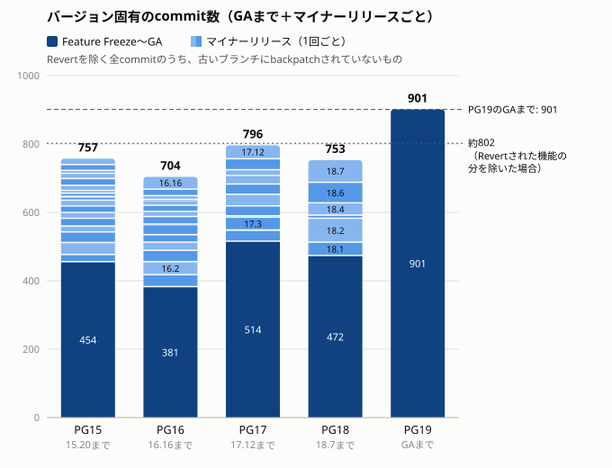
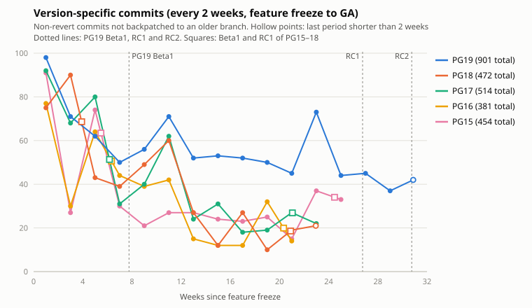
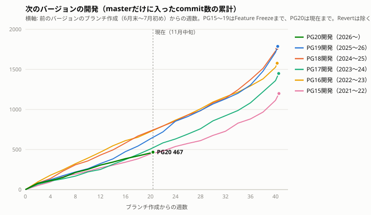

2026年11月19日に[PostgreSQL 19](https://www.postgresql.org/about/news/postgresql-19-released-3449/)がリリースされました！PostgreSQL 16〜18は9月中旬から下旬（PostgreSQL 15は10月）にリリースされていたので、今年は約2か月遅れたことになります。

遅れた理由はいくつかありますが、その一つはAIの台頭です。AIを使ったレビューやテストによって、セキュリティの問題を含むバグが例年よりずっと多く報告されるようになり、その対応に開発者の時間が取られました。このあたりの事情はPeter Eisentrautさんの記事「[The reverts will continue until morale improves](https://peter.eisentraut.org/blog/2026/10/09/the-reverts-will-continue-until-morale-improves)」に詳しく書かれています。AIのレビューが一般的になる前に開発された機能が、ベータ期間に入ってからAIのレビューを受けた、という見方もあります。

また、PostgreSQL 19では、一度コミットされた機能のうち、いくつかがベータ期間中にRevertされたことも少し話題になりました（UPDATE/DELETE FOR PORTION OF、SQL/PGQ、ALTER TABLE ... MERGE/SPLIT PARTITION、オンラインでのデータチェックサムの切り替えなど）。

自分の体感としても、今回はとにかくバグ報告が多く、例年のリリースと比べてずっと忙しい感じがありました。そこで、PostgreSQL 19のFeature FreezeからGAまでにどれくらいのバグが報告・修正されたのか、例年と比べてどうだったのかを数えてみました。比較対象はPostgreSQL 15〜18です。

## Open Itemsの数

PostgreSQLでは、Feature Freezeからリリースまでの間に見つかった問題を、Wikiの「Open Items」というページで管理しています（例えば[PostgreSQL 19 Open Items](https://wiki.postgresql.org/wiki/PostgreSQL_19_Open_Items)）。まずは、ここで「解決済み」になった項目の数を比べてみます。

| バージョン    | 解決済みのOpen Items |
|---------------|----------------------|
| PostgreSQL 15 | 70                   |
| PostgreSQL 16 | 35                   |
| PostgreSQL 17 | 63                   |
| PostgreSQL 18 | 59                   |
| PostgreSQL 19 | **209**              |

例年の3〜6倍です。中身を見てみると、新機能のRI fast-path（外部キーチェックの高速化）とREPACK (CONCURRENTLY)の2つに関するものがそれぞれ約20件あり、新しく入った大きな機能に問題が集中していたことがわかります。

## コミットログで数える

Open Itemsを数えることは手軽ですが、そこに全ての修正が載るわけではありません。軽微な修正はOpen Itemsに載せずにそのままコミットされることも多いですし、1つの項目に複数の修正がまとめられていることもあります。そこで、コミットログから修正の数を数えてみます。

Feature Freeze(2026年4月)以降は新しい機能は入らないので、その後にコミットされるのはほぼ全てが何らかの修正です。そこで、Feature FreezeからGAまでの間にそのバージョンのブランチ（PostgreSQL 19なら`REL_19_STABLE`）に入ったコミットのうち、Revertを除いた全てを修正として数えました。ドキュメントやテストの修正も含みます[^house]。

[^house]: リリースノートや翻訳の更新のようなコミットも含まれていますが、どのバージョンも数件から20件程度なので、結果にはほとんど影響しません。

さらに、そのうち1つ前のバージョン以前のブランチにはbackpatchされていないものを「バージョン固有の修正」と呼ぶことにします。古いブランチにもbackpatchされた修正は、そのバージョンより前からあったバグの修正なので、バージョン固有の修正は、そのバージョンで入ったバグの修正と考えられます。

PostgreSQL 19は873件で、例年（361〜491件）の約1.8〜2.4倍でした。期間も例年より1〜2か月長いので1日あたりで比べると、2.3〜2.9件に対して3.9件で、1.3〜1.7倍になります。

期間ごとに1日あたりの件数を見てみると、もう少し面白いことがわかります。

|               | FF → Beta1 | Beta1 → RC1 | RC1 → GA |
|---------------|-------------|--------------|-----------|
| PostgreSQL 15 | 4.7         | 1.9          | 1.4       |
| PostgreSQL 16 | 4.0         | 1.8          | 0.6       |
| PostgreSQL 17 | 5.4         | 2.2          | 1.5       |
| PostgreSQL 18 | 5.7         | 2.3          | 1.1       |
| PostgreSQL 19 | 4.9         | **3.9**      | **2.7**   |

Feature FreezeからBeta1までは、PostgreSQL 19は例年とほとんど変わりません。例年はBeta1を過ぎると修正のペースが半分以下に落ちますが、PostgreSQL 19はあまり落ちませんでした。つまり、例年との違いはほぼベータ期間に入ってからの分です。Peterさんの記事にも書いてありますが、4月から8月にかけて多くのシニアな開発者がセキュリティ問題の対応に追われ、ベータ版のレビューやテストに本格的に手が回り始めたのは8月からでした。月ごとに見ても、PostgreSQL 19固有の修正は8月に一度減った（101件）あと、9月に再び増えていて（124件）、この話とも合っています。

ちなみに、PostgreSQL 19のうち約100件は、最終的にRevertされた機能（FOR PORTION OFやSQL/PGQなど）に対する修正でした。これを除いても約770件で、例年の1.6〜2.1倍です。また、そもそもPostgreSQL 19は大きなリリースで、開発期間中に追加された行数はPostgreSQL 18より4割ほど多かったので、その分バグが多かったという面もあると思います。

### GA後のマイナーリリース何回分？

これまでの感覚では、x.0がリリースされた後もマイナーリリースでバグが潰されていって、だいたいGAから1年後くらいのバージョン（x.3〜x.4あたり）から使われることが多い印象でした。では、PostgreSQL 19がGAまでに直した873件は、例年のGA後のマイナーリリース何回分に相当するのでしょうか。

同じ条件（Revertを除き、古いブランチにbackpatchされていないもの）で、GA後にマイナーリリースごとに入ったコミットを数えて、GAまでの件数に積み上げてみました。

PostgreSQL 15〜18は、どれも最新のマイナーリリースまで積み上げても873件に届いていません。GAから4年経ったPostgreSQL 15も15.20までで752件です。一番近いのはPostgreSQL 17で、GAから2年以上経った17.12までで770件です。PostgreSQL 19の873件にはRevertされた機能に対する修正（約100件）も含まれているので、それを除いた約774件と比べるのが公平かもしれませんが、それでもPostgreSQL 17が17.12までにやっと並ぶくらいです。つまり、PostgreSQL 19は、例年なら2年くらいかけてマイナーリリースで直していく分を、GAまでに直したことになります。

もちろん、PostgreSQL 19はそもそも入ったコードの量が多いので、修正の数が多いのはある程度自然です。開発期間（前のバージョンのブランチ作成からFeature Freezeまで）に追加された行数は、PostgreSQL 15〜18が18万〜23万行だったのに対して、PostgreSQL 19は約33万行でした。追加された1000行あたりの修正数にならしてみると、PostgreSQL 15〜18が2.0〜2.2件、PostgreSQL 19が2.7件で、差は1.2〜1.4倍くらいに縮まります。

ただし、比べる側の数も動いていることには注意が必要です。2026年に入ってからは、マイナーリリース側でもAIによる報告が増えていて、18.6と18.7はそれぞれ60件を超えています。

## バグは収束しているのか？

では、たくさん直した結果、PostgreSQL 19のバグは収束してきているのでしょうか。

例年は、Feature Freeze直後の2週間に70〜90件あったのが、GA前には20〜30件くらいまで減っています。PostgreSQL 19も最初の2週間は93件と例年並み（やや多いくらい）でしたが、その後もずっと40〜70件のまま推移しました。9月前半（22〜24週目）には73件の山があります。

RC1からGAまでのペースは1日2.7件で、RC1の前（1日4.2件）よりは下がりました。ただ、例年の同じ時期（0.6〜1.5件）よりずっと多く、PostgreSQL 18のBeta1からRC1までの平均（2.3件）よりも高い水準です。最後の6週間も44件、43件、37件と少し減ったくらいで、GA直前の12日間でも42件入っています。

AIを使って探す人が増えると、同じ数のバグが残っていても、見つかる数は増えます。なので、件数が多いことが「バグがまだ多く残っている」ことを表しているのか、「よく探すようになった」ことを表しているのかは、件数だけではなんとも言えません。

また、RC1の後の11月は、マイナーリリース（18.7など）の準備もあり、そちらにも人手が取られていたと思います。18.7ではCVEが53件も修正されています。

GA時点では、Open Itemsの未解決の項目は0件になりました。

## PostgreSQL 19以外でも

ここまではPostgreSQL 19固有の修正を見てきましたが、バグ報告が多かったのはPostgreSQL 19だけではありません。Feature FreezeからGAまでの間に`REL_19_STABLE`に入ったコミットのうち、古いブランチにもbackpatchされたもの、つまりPostgreSQL 19より前からあったバグの修正は725件でした。PostgreSQL 15〜18の同じ期間では190〜260件くらいなので、3〜4倍です。

サポートされている一番古いブランチ（`REL_14_STABLE`）に入ったコミットの数を見ると、2024年から2026年前半までは月に30件前後でほぼ一定だったのが、2026年後半は月に60件以上と倍になっています。11月は前半だけで95件で、まだ増えています。

体感としても、PostgreSQL 19以外の部分にもとても多くのバグが報告されています。中には重要なものもあれば、そうでもないものもあり、それらが混ざって大量に届いている、という感じです。この状況は、少なくとも当面は続きそうです。

## PostgreSQL 20の開発への影響は？

PostgreSQL 19のバグ修正やセキュリティ問題の対応に開発者の時間が取られたとすると、次のバージョン、つまりPostgreSQL 20の開発にも影響が出ているかもしれません。PostgreSQL 20の開発は、7月初めに`REL_19_STABLE`ブランチが作られてから始まっています。そこで、ブランチ作成後にmasterだけに入ったコミット（`REL_19_STABLE`には入っていないもの）を、次のバージョンの開発として数えて、例年と比べてみました。

現在（ブランチ作成から約20週）までに、PostgreSQL 20の開発としては466件のコミットが入っています。同じ時点で比べると、PostgreSQL 16〜19の開発では517〜734件だったので、それよりは少なめです。PostgreSQL 20は、12週目（9月下旬）くらいまではPostgreSQL 19の開発とほぼ同じペースでしたが、そこから伸びが鈍っています。ちょうど、PostgreSQL 19のベータ期間の後半からRC、マイナーリリースの準備が重なっていた時期です。

ただし、PostgreSQL 15の開発では同じ時点で441件、PostgreSQL 17の開発では517件だったので、例年の範囲から大きく外れているわけではありません。また、開発のペースはそのバージョンでどんな機能が開発されているかによっても大きく変わりますし、PostgreSQL 19でRevertされた機能のうち、いくつか（オンラインでのデータチェックサムの切り替えなど）はmasterには残ったままです。なので、この比較はあくまでも参考程度です。

## まとめ

PostgreSQL 19のFeature FreezeからGAまでのバグ修正を数えてみました。

- Open Itemsで見ても、コミットログで見ても、例年よりずっと多くのバグが修正された
- 例年との違いは、ほぼベータ期間に入ってからの分
- GAまでに直した数は、これまでのどのバージョンが最新のマイナーリリースまでに直した数よりも多い（例年の2年分くらい）
- ただし、修正のペースは下がってきているものの、例年の同じ時期よりはまだ高い。バグが多く残っているのか、よく探すようになったのかは、件数だけではわからない
- PostgreSQL 19以外の古いブランチでも、修正の数は増え続けている
- PostgreSQL 20の開発は、例年の範囲内ではあるが少なめ

「GAまでにたくさん直した」のは確かです。19.0は、例年のx.0よりも安定したリリースになっているかもしれません。一方で、「直すべきバグが少なく残っている」かどうかはまだわかりません。半年後くらいに、19.1〜19.3でPostgreSQL 19固有の修正が何件出たか、古いブランチへの修正がどうなったかと合わせて、答え合わせをしてみたいと思います。
